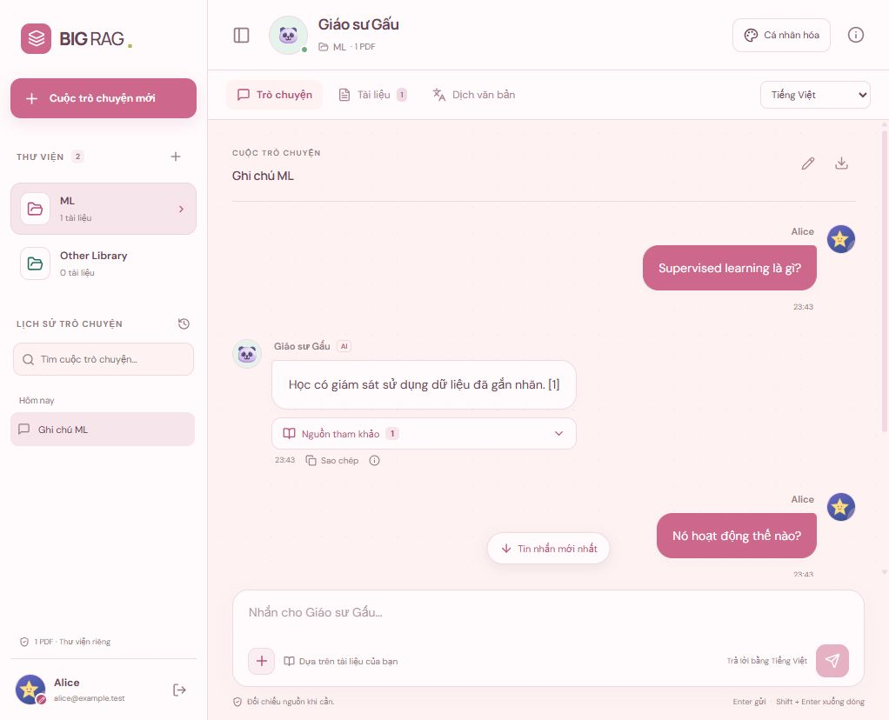
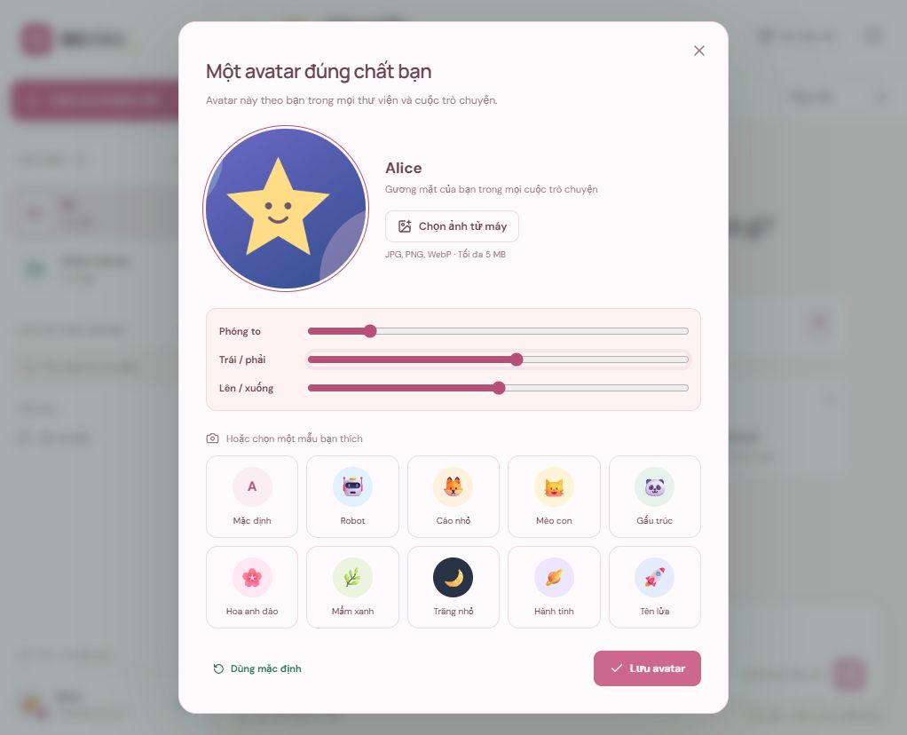
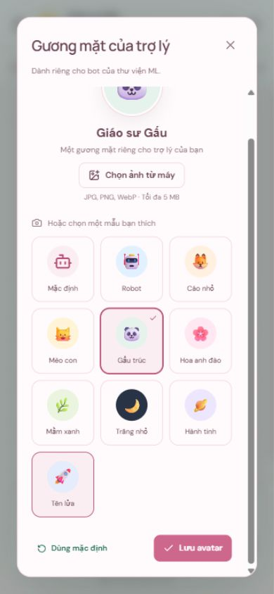

# Avatar cá nhân và avatar bot — 09/10/2026

Đã cập nhật ứng dụng chính tại http://localhost:8501 và bản QA tại http://127.0.0.1:8510. Tải lại trang để dùng giao diện mới.

## Cách dùng

- Avatar của bạn: bấm ảnh tròn cạnh tên hồ sơ ở cuối menu; trên điện thoại mở menu trước. Avatar dùng cho mọi thư viện.
- Avatar bot: bấm ảnh bot ở đầu khung chat, hoặc mở Cá nhân hóa → Đổi avatar bot. Mỗi thư viện có một lựa chọn riêng.
- Chọn trong 10 lựa chọn (gồm mặc định) hoặc tải JPG/PNG/WebP, tối đa 5 MB và 20 triệu pixel. Ảnh tải lên có khung tròn, thanh zoom và điều chỉnh ngang/dọc. Chỉ áp dụng khi bấm Lưu avatar.
- Có thể giữ ảnh hiện tại hoặc dùng mặc định. Avatar xuất hiện trong hồ sơ, đầu chat, lời chào, tin nhắn, trạng thái đang trả lời và bảng thông tin thư viện.

## Lưu trữ

Bảng MySQL `avatars` giữ lựa chọn và JPEG 384 × 384, gắn `user_id` và slot hồ sơ/bot thư viện. API kiểm tra phiên và quyền sở hữu; URL ảnh không công khai. Server đọc nội dung thật bằng Sharp, giới hạn pixel/byte, từ chối SVG/file hỏng, chuẩn hóa JPEG và không giữ metadata EXIF. Không dùng localStorage để lưu avatar. Quyền CRUD của tài khoản MySQL ứng dụng được giữ nguyên.

Migration `scripts/migrate_avatars.mjs` đã thêm bảng vào `big_rag` và `big_rag_tests`; không sửa tài khoản, PDF hoặc lịch sử cũ. Node đã khởi động lại với API mới; GPU worker giữ nguyên. Cách xử lý ảnh dựa trên [tài liệu Sharp](https://sharp.pixelplumbing.com/api-constructor/) và [JPEG output](https://sharp.pixelplumbing.com/api-output/).

## Kiểm thử

| Kiểm tra | Kết quả |
| --- | --- |
| Node/MySQL | 11/11, gồm 2 trường hợp mới về avatar |
| Render chat | 9/9, gồm ảnh tài khoản, avatar bot và chặn URL ảnh ngoài ứng dụng |
| Build | Thành công |
| Preset | Xem trước và lưu được; bot riêng thư viện, avatar tài khoản dùng chung trong các thư viện của chính người đó |
| Tải ảnh và cắt | Ảnh PNG mẫu được cắt; zoom 1.3, dịch ngang 10; ảnh trả về JPEG 384 × 384 hiển thị trong hồ sơ/tin nhắn |
| Tải lại / đăng nhập lại | Avatar ảnh và bot được khôi phục |
| File không hỗ trợ | SVG giả PNG/file hỏng/quá 5 MB bị server từ chối; chọn SVG trong giao diện hiện thông báo rõ |
| Quyền riêng tư | Tài khoản khác và người chưa đăng nhập không tải được ảnh của chủ tài khoản; không chỉnh được bot của thư viện khác |
| Mobile 390 × 844 | Không tràn ngang; chọn/lưu avatar được. Tiêu đề/nút đóng luôn hiện, phần lựa chọn cuộn riêng |
| Console QA | Không có lỗi hoặc cảnh báo |

QA dùng tài khoản Alice trong `big_rag_tests`, ảnh ngôi sao mẫu và câu trả lời RAG giả lập. Không thay avatar/tài liệu của tài khoản production trong quá trình kiểm thử. Đã giữ bản QA mở để xem trực tiếp.

Mã chính: `shared/avatars.mjs`, `server/avatars.mjs`, `src/workspace/AvatarUI.jsx`, `src/workspace/avatars.css`, cùng tích hợp trong `src/App.jsx`, `ChatUI.jsx` và API Express. Thư viện Sharp 0.35.5; npm audit sau cài đặt báo 0 lỗ hổng.
