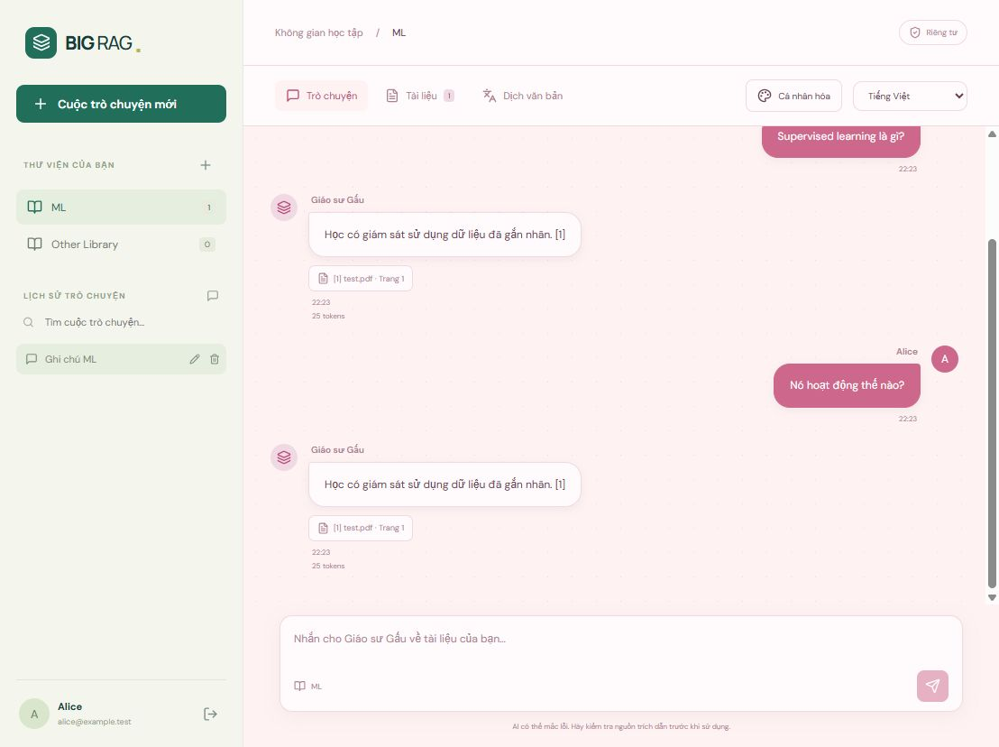
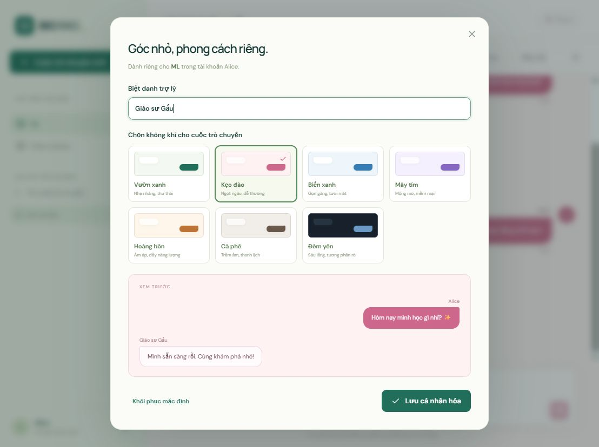

# Nâng cấp React / Node.js / MySQL và cá nhân hóa chat

Đã triển khai tại http://localhost:8501. React/Vite thay giao diện Streamlit; Express quản lý đăng nhập, MySQL và API cho frontend. Python/FastAPI còn làm dịch vụ RAG/GPU nội bộ, yêu cầu secret, chỉ bind localhost.

## Dữ liệu và bảo vệ tài khoản

- Database `big_rag` đã tạo, user ứng dụng chỉ có quyền CRUD. Credential root dùng cho setup không còn trong `.env`.
- Bcrypt cost 12; từ chối mật khẩu dưới 8 ký tự hoặc vượt 72 byte UTF-8.
- Session token ngẫu nhiên trong cookie HttpOnly / SameSite=Lax; MySQL chỉ lưu SHA-256 token, có hết hạn và thu hồi khi đăng xuất. Không có credential/token trong localStorage.
- Owner filter trên tài liệu, preview, hội thoại và tùy chỉnh; kiểm tra Origin cho thao tác ghi, giới hạn đăng nhập sai.
- MySQL giữ PDF BLOB, text/vector, bản dịch, chat và metadata nguồn/token. Chroma là chỉ mục tìm kiếm có thể phục hồi từ MySQL.
- Preview lưu MySQL, bản dịch chỉnh sửa xác nhận được dù worker đã khởi động lại. Kết nối MySQL dùng UTC; đã sửa lệch múi giờ làm preview hết hạn sớm.

## Thư viện đã chuyển

3 chủ đề, 8 PDF, 196 đoạn/vector đã chuyển vào MySQL, mọi hash PDF và số vector khớp. Riêng **Mchine Learning**: 7 PDF, 167 trang, 41 trang OCR, 188 đoạn. Thư viện cũ ở bảng staging trước khi có tài khoản; người đăng ký đầu tiên nhận trong transaction. Các tài khoản sau không nhận dữ liệu này.

Lỗi import cũ và cách sửa GPU được ghi trong [báo cáo import](import-mchine-learning-2026-10-09.md): launcher venv trỏ Python cũ có PyTorch CPU, trong khi CUDA đã cài ở venv mới. Đã sửa launcher và xác nhận PyTorch `2.14.1+cu126`, CUDA khả dụng trên RTX 2050.

## Chat cá nhân hóa

- Bong bóng tin nhắn hai phía: người dùng bên phải, bot bên trái, độ rộng co theo nội dung.
- Hiện tên tài khoản thay nhãn “Bạn”; tên bot theo biệt danh của từng thư viện.
- 7 theme: Vườn xanh, Kẹo đào, Biển xanh, Mây tím, Hoàng hôn, Cà phê, Đêm yên. Có xem trước và khôi phục mặc định.
- `topics.bot_name` và `topics.theme` lưu MySQL, ràng buộc theo chủ sở hữu; đổi thư viện đổi theme/bot, refresh vẫn giữ tùy chỉnh.
- Lịch sử lưu nguồn, số trang và usage; tìm, mở lại, đổi tên, tải txt và xóa. Ngữ cảnh follow-up giới hạn 8 tin nhắn/600 token ước lượng.

## Kiểm chứng

- `npm run build`: đạt.
- Python: 41 tests đạt, gồm private workspace, secret worker, ingest preview đã lưu và phục hồi vector từ MySQL không embedding lại.
- Node: 9 tests đạt trên database riêng `big_rag_tests`, worker giả lập. Kiểm tra auth/bcrypt/session/CSRF, quyền hai người dùng, PDF/chunks/vectors, lịch sử và tùy chỉnh độc lập từng thư viện.
- Worker thật: hỏi tài liệu Mchine Learning nhận câu trả lời, 4 nguồn PDF/số trang và usage Groq; gọi worker thiếu secret bị 401.
- Trình duyệt: đăng nhập/đăng xuất/đăng ký; tài khoản mới thư viện trống; tạo chủ đề, nhập PDF; mở lịch sử sau refresh; sửa nickname/theme, chuyển thư viện và refresh vẫn giữ đúng dữ liệu.
- QA chỉ dùng database riêng, không tạo tài khoản thử trong database chính. Thư viện chính vẫn dành cho tài khoản đầu tiên của người dùng.

Ảnh kiểm thử giao diện:

Vận hành/sao lưu: [README](../README.md). Khởi động lại bằng `scripts/start.ps1`.
