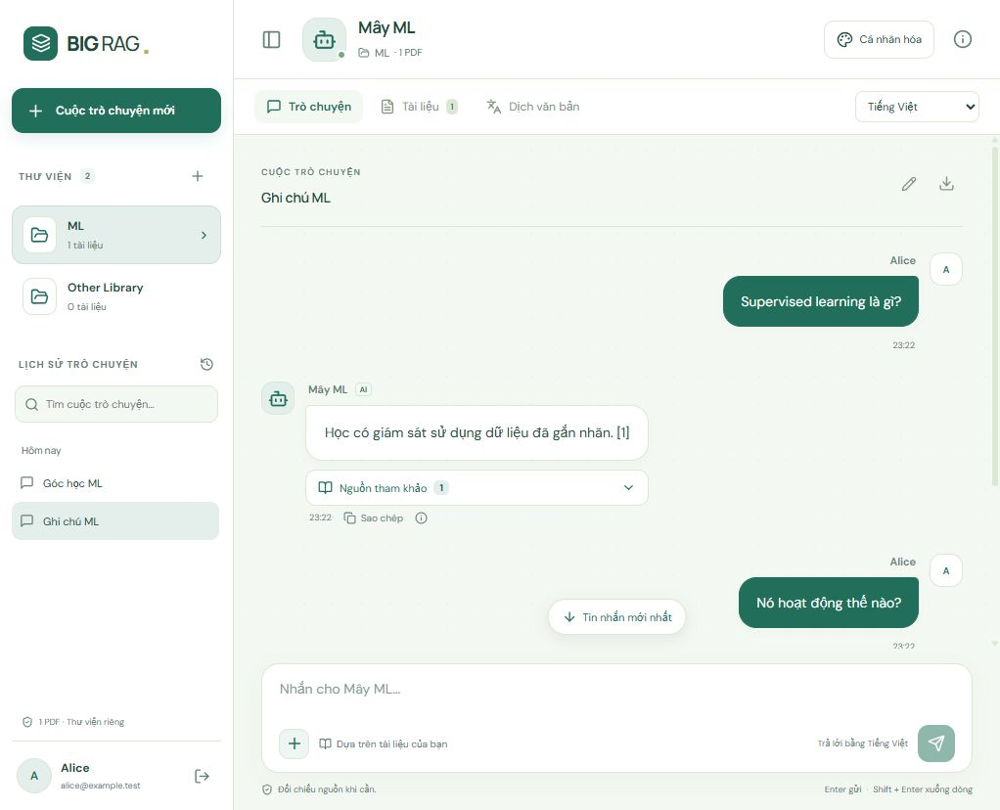
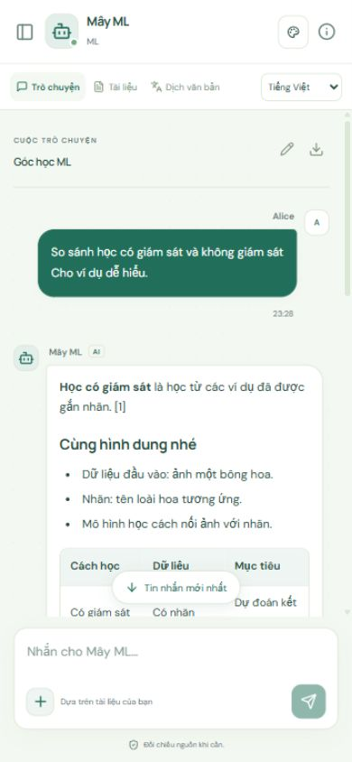
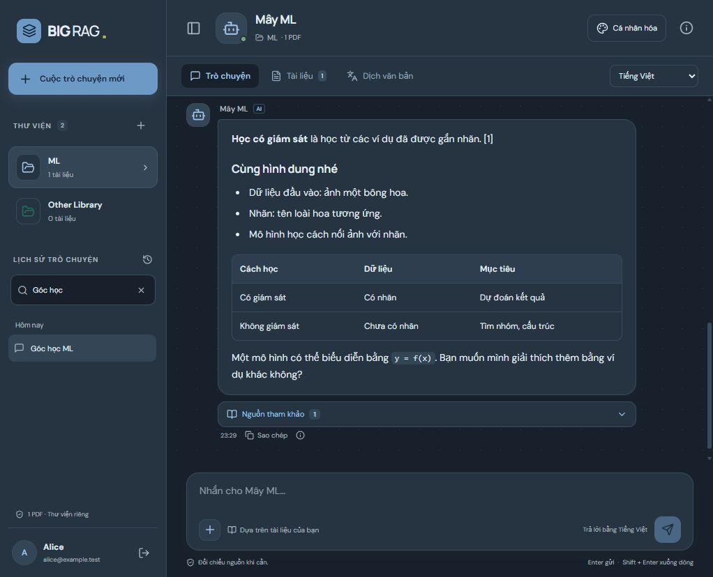

# Thiết kế lại khung chat BIGRAG — 09/10/2026

## Kết quả

Đã build giao diện mới cho ứng dụng tại http://localhost:8501. Tải lại trang và đăng nhập để dùng. Trang giới thiệu giữ bố cục hiện có; ba ảnh mẫu vẫn chỉ dùng ở trang giới thiệu.

- Bên trái: thư viện với màu riêng, tìm lịch sử, nhóm hội thoại theo ngày, tạo/đổi tên/tải chat. Có chế độ thu gọn 76px trên desktop và menu ngăn kéo trên điện thoại.
- Trung tâm: chat hai phía, tên tài khoản và biệt danh bot, avatar, giờ gửi. Ô nhập cố định; gợi ý câu hỏi, xuống dòng bằng Shift + Enter, trạng thái đang đọc và tự focus lại khi gửi xong.
- Nguồn tham khảo mở theo yêu cầu, có tên file, trang, đoạn trích; liên kết PDF gốc khi nguồn khớp tài liệu. Câu trả lời hỗ trợ Markdown, bảng, danh sách và code; có sao chép. HTML, URL không an toàn và ảnh từ xa trong câu trả lời bị chặn.
- Bảng thông tin bên phải hiển thị tài liệu, số trang, trợ lý và nút chỉnh theme. Theme áp dụng cả menu, chat, tài liệu, dịch và popup. Tùy chỉnh vẫn lưu MySQL riêng từng thư viện.
- Khi đang đọc tin cũ, chat giữ vị trí đọc và có nút về tin mới nhất. Giao diện tôn trọng chế độ giảm chuyển động.

## Kiểm thử đã thực hiện

| Kiểm thử | Kết quả |
| --- | --- |
| `npm run test:node` | 9/9: auth, bcrypt, phiên, CSRF, quyền sở hữu, PDF/vector, lịch sử và tùy chỉnh |
| `npm run test:ui` | 7/7: Markdown, bảng/code, nội dung không an toàn, tên người dùng, nguồn PDF, trạng thái bắt đầu |
| `npm run build` | Thành công, bản build cuối đã được phục vụ |
| Gửi bằng Enter / Shift + Enter | Gửi được, giữ xuống dòng; có trạng thái chờ, focus lại ô nhập khi hoàn tất |
| Nguồn / sao chép / tải chat | Mở được trang và đoạn trích; clipboard có nội dung; file `.txt` có Alice và biệt danh bot |
| Tìm / đổi tên / mở lại lịch sử | Tìm đúng hội thoại, đổi thành “Góc học ML”, vẫn còn sau tải lại và tiếp tục chat được |
| Biệt danh / theme riêng | “Mây ML”, theme tối và xanh lưu được; thư viện thứ hai giữ BIGRAG/theme mặc định |
| Tài liệu / dịch | Mở từ bảng thông tin, danh sách PDF có liên kết; gửi đoạn dịch và hiển thị phản hồi mẫu |
| Desktop | Menu thu gọn 76px, mở lại lịch sử được; kiểm tra theme sáng/tối |
| Mobile 390 × 844 | Không tràn ngang (scrollWidth = 390); ô nhập cố định tới đáy 844; menu mở/đóng, lịch sử, bảng thông tin và popup dùng được |
| Điều hướng mobile | Menu đã đóng có visibility hidden và aria-expanded false; không còn các nút khuất trong cây truy cập |
| Nhảy tới tin mới nhất | Cuộn về cuối, khoảng cách tới đáy 9px |
| Console trình duyệt / log QA | Không ghi nhận lỗi hoặc cảnh báo |

Kiểm thử trình duyệt dùng tài khoản Alice trong **big_rag_tests**, server riêng **http://127.0.0.1:8510**, phản hồi RAG/dịch giả lập. Kết quả trên xác nhận luồng giao diện và lưu MySQL; không đánh giá chất lượng câu trả lời Groq hoặc tốc độ GPU. Kiểm thử GPU/import thật đã có báo cáo riêng trước đó. Không tạo tài khoản hay thay tài liệu trong database production bằng thao tác QA này.

Trong lúc test đã sửa lỗi mất focus sau gửi, tiêu đề tab chưa cập nhật tên bot và menu mobile đóng nhưng vẫn xuất hiện trong điều hướng bàn phím. Đã kiểm tra lại các trường hợp này sau sửa. Các kiểm tra Python đã qua ở đợt backend trước; không chạy lại cho thay đổi giao diện này.

## Ảnh kiểm thử

## Mã chính

- `src/App.jsx`: điều hướng workspace, trạng thái gửi, lịch sử, sidebar, header và kết nối các công cụ.
- `src/workspace/ChatUI.jsx`: tin nhắn, render Markdown, nguồn, sao chép, lời chào, ô nhập và bảng thông tin.
- `src/workspace/workspace.css`: bố cục responsive và theme toàn workspace.
- `scripts/check_chat_render.mjs`: kiểm tra render; `scripts/qa_web.mjs` và `server/test-rag.mjs`: môi trường QA riêng.
